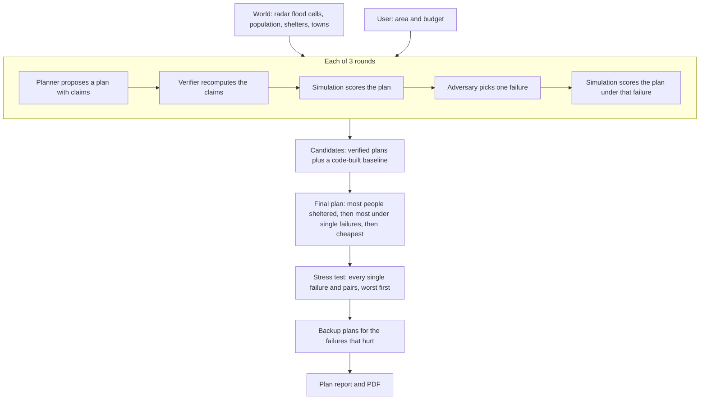

# How a plan is made, attacked and verified

This document walks through one run, from the moment someone clicks "Build plan" to the final report.
It describes the code on `main` as of 2026-10-25 (the Cascade design in `docs/plan.md`).
File paths point at the module that does each step.

## The short version

- **AI proposes, code checks.** The Planner (Gemma 4, or a rule-based planner) proposes a plan and states what it costs and how many people it shelters.
  The Verifier never trusts those numbers: it recomputes them with the Simulation and rejects the plan if they do not match.
- **The Adversary tests, it does not change the world.** Each round, it picks the one failure that hurts that round's plan most.
  The failure is recorded with the plan's result under it, then dropped; the next round plans for the user's conditions again.
- **Code picks the final plan and stress-tests it.** Every verified plan competes with a plan built entirely by code.
  The winner is then scored under every single failure and many pairs, and code builds backup plans for the ones that hurt.
- **"Verified" means the plan's own numbers are true under our model of the Big Bend.**
  It does not mean the model is right about the real hurricane; the limits are at the end of this document.

## 1. The World: what the plan is checked against

Before any run, `uv run python -m proofloop.world.build` builds the World once and caches it (`backend/src/proofloop/world/`).
It is a grid of about 60 m cells over Dixie and Taylor counties, and holds:

- **Which cells are flooded**, from NISAR L-band radar before (Sep 28) and after (Oct 10) the storm.
  A cell is flagged when its radar return darkened (open water) or brightened beyond the scene's typical change (water under tree canopy).
  This is a yes/no per cell with a confidence, not a water depth.
- **How many people live in each cell**, spread from 2020 Census blocks.
- **The four public shelters**, with capacity from the 2020 Florida Statewide Emergency Shelter Plan and an assumed cost of $25 per space.
- **Six towns** (Keaton Beach, Steinhatchee, Horseshoe Beach, Suwannee, Cross City, Perry), each a center with a 4 km radius, used for transport and road closures.
- **How far people can travel** to a shelter: 60 km of grid steps through dry cells.

Everything below runs on this cached World; nothing reads the raw radar files during a run.

## 2. What the user chooses

On the start card the user picks only:

- **Area:** the whole area, or one town (then only that town's affected people count).
- **Budget:** a dollar amount.
- **Planning engine:** the AI planner (Gemma 4) or Instant (rule-based).

These form the **Scenario**: the conditions every plan in the run is made, checked and scored for.
Which shelters fail, which roads close and how deep the budget is cut are not chosen by the user; the Adversary and the stress test find them.

## 3. The Simulation: the single source of truth

`backend/src/proofloop/loop/simulation.py` turns a plan and a Scenario into numbers, with no randomness and no AI.

1. **Who is affected:** everyone living in a flagged cell (within the chosen town, for a one-town plan).
2. **Funding:** actions are paid for in the order the plan lists them, until the first one the budget cannot cover; that action and every later one get no money.
   A contingency reserve is money held back, so it is not spent.
3. **Walking or driving to shelter:** each open shelter takes the nearest affected people who can reach it through dry cells within the travel reach, up to its capacity.
   People in a town whose road is closed cannot reach a shelter outside that town.
4. **Transport:** staged transport carries a town's remaining affected people, nearest to the town center first, into open shelters that still have beds, even past a closed road ($150 per seat, an assumption).
5. **Result:** people affected, sheltered and unreached, the cost, the share sheltered (robustness), and how many actions went unfunded.

Every number in the Verifier, the stress test, the report and the evidence trail comes from this function.

## 4. One round, step by step

`run_proofloop` in `backend/src/proofloop/loop/__init__.py` runs 3 rounds.
Each round does the following.

### 4.1 The Planner proposes a plan

A plan is a list of actions plus two claims:

- **Actions:** open a shelter; stage transport (town, number of seats); hold back a contingency reserve (at least $1,000).
- **Claims:** what the plan costs and how many people it shelters.
- **Rationale:** a few sentences for the emergency manager, citing the source pack.

**The Gemma Planner** (`backend/src/proofloop/gemma/agents.py`) is told to shelter every affected person first, and to hedge against failures found in earlier rounds only with money left over.
It sees the shelters (capacity, cost, how many each could shelter alone), the towns, the budget, the source pack, and a summary of earlier rounds including the Verifier's findings and the Adversary's failures.
It works in steps, using the Simulation as a calculator:

1. **Draft:** Gemma drafts a plan.
2. **Check:** code simulates the draft and tells Gemma what it really costs and shelters, with each action's exact cost.
   If the draft is over budget, the check lists concrete cuts (for example "lower the reserve to $X" or "stage N fewer seats").
3. **Final plan:** Gemma writes its final plan and claims.
4. **Second check, only if needed:** if the final plan would still fail verification, Gemma gets one more try with the Verifier's reasons.
   If only its arithmetic is wrong, it is told the exact numbers to claim for the same actions.

Gemma's answers are forced into the plan's JSON shape, and shelter and town ids are restricted to real ones, so it cannot invent places.
Calls go to OpenRouter first and fall back to the Gemini API.

**The rule-based Planner** (`backend/src/proofloop/loop/demo.py`) proposes the code-built baseline plan described in section 5.
In round 2 it overstates the people it shelters by 25% on purpose, so the Verifier has something to catch in demos.

If a Planner's output is invalid (bad JSON, unknown places, an exception), the error is recorded and the round re-tests the best earlier plan instead, marked as a re-test.

### 4.2 The Verifier checks the plan

`backend/src/proofloop/loop/verifier.py` runs the Simulation on the plan under the Scenario and makes five checks:

| Check | Passes when |
|---|---|
| **cost** | the claimed cost is within $0.50 or 1% of the recomputed cost |
| **people_sheltered** | the claimed number is within 0.5 people or 1% of the recomputed number |
| **budget** | the recomputed cost is no more than the budget |
| **capacity** | the claim is no more than the open shelters can hold |
| **places_available** | every shelter and town exists, and no opened shelter is offline |

A plan that fails any check is **rejected**, with the reasons shown, for example "claimed 1,199, recomputed 960" or "costs $166,350, budget is $150,000".
A plan is rejected only for its own mistakes, never because a failure would hurt it.

### 4.3 The Simulation scores the plan

The round records the plan's result under the Scenario: how many people it shelters as planned, and at what cost.

### 4.4 The Adversary tests the plan with one failure

The Adversary picks the single failure that would hurt this plan most:

- **shelter offline:** power loss, flooding or a staff shortage closes a shelter;
- **road closed:** a town's road is cut, so its people cannot reach a shelter outside the town on their own;
- **budget cut:** 10 to 50% of the money disappears, and the plan's last actions lose funding.

**The Gemma Adversary** sees only the current conditions and the plan it attacks, in a fresh API call; it never sees the Planner's reasoning.
**The rule-based Adversary** tries every single failure and picks the one that leaves the fewest people sheltered.

An attack on an unknown place, outside a one-town plan's town, or already in effect is invalid and is recorded as an error.

The Simulation then scores the same plan with that failure applied, and the round records it, for example "Dixie County High School goes offline: 453 of 960 sheltered".

### 4.5 The failure does not carry forward

The failure is a test, not a change to the world.
The next round plans again for the user's original Scenario.
The Planner sees the failures found so far in its round summary, so it can hedge against them if money allows.

Earlier versions piled the attacks up from round to round; by the last round several shelters were offline and the budget was cut, so plans were judged against a disaster and runs could end with nothing.
That was replaced on 2026-10-24.

## 5. Choosing the final plan

After the 3 rounds, `_recommend` collects the **candidates**:

- every round's plan that passed verification (re-tests do not count twice);
- a **baseline plan built entirely by code** (`backend/src/proofloop/loop/baseline.py`): the affordable set of shelters that shelters the most people, and among those the one that best survives losing a shelter, plus transport for towns whose road the Adversary closed when it helps and fits the budget.

The baseline always competes, so the final plan never shelters fewer people than the budget allows, and a run always ends with a plan.

Candidates are ranked by, in order:

1. the share of affected people sheltered under the user's conditions;
2. the average share sheltered across every single failure (each opened shelter offline, each affected town's road closed, budget cuts of 10, 25 and 50%);
3. lower cost;
4. the earlier candidate, so the baseline (listed last) wins only by strictly improving on a Planner's plan.

If the final plan leaves people unsheltered and money is the only reason, the report gives the cheapest set of shelters that takes everyone, and the run screen offers to re-plan with that budget.

## 6. The stress test and backup plans

The final plan is then tested much harder than one failure per round (`backend/src/proofloop/loop/stress.py`).
Code scores it under:

- **every single failure:** each shelter it opens going offline, each affected town's road closing, and budget cuts of 10, 25 and 50%;
- **every pair of them** (never two budget cuts);
- **everything the Adversary found, all at once.**

For the whole area that is about 75 cases and takes about a second.
Cases are sorted worst first.
Single failures are small trouble a plan should ride out; pairs are major trouble, reported but never held against the plan.

For every single failure, the 5 worst pairs and the combined case, code builds a **backup plan** for those exact conditions (the baseline, knowing the failure) and keeps it only if it shelters at least half a person more.
The report shows each backup as what to change, for example "Open Taylor County Elementary School instead of Taylor County High School", with how many it shelters.

## 7. What the user sees

- **While running:** a progress card with three stages (Draft, Strengthen, Finish); rounds stream from the API as they finish (`POST /api/loop/stream`).
- **The report:** the final plan written up under FEMA CPG 101 headings (`backend/src/proofloop/loop/report.py`), with assignments, the budget, a per-neighborhood briefing, the stress test with backup plans, limitations and references, downloadable as a PDF.
  Every number in it comes from the same Simulation trace.
- **Other plans:** a second tab lists every other plan from the run as "Rejected" (with the Verifier's reason) or "Not chosen" (with how it compares).

## 8. What "verified" does and does not mean

**It does mean:**

- the plan's cost and people-sheltered claims match an independent recomputation;
- the plan is within budget, uses only real, open shelters and real towns, and does not claim more than the shelters hold;
- the plan's behavior under every single failure and the worst pairs has been computed, not guessed.

**It does not mean the real-world outcome is guaranteed.**
The Verifier checks the plan against the model; it cannot check the model against reality.
The main assumptions:

- **Flooding is radar-observed water change, not depth.** One pass, about a day after landfall; water that drained earlier or rose later is missed.
  Most flagged cells are water under tree canopy, the less certain signal; rain-wet ground can look similar.
- **Everyone in a flagged cell needs shelter**, and everyone who can reach a shelter goes.
  Real evacuation rates are lower and vary.
- **Travel is along a grid through dry cells**, within 60 km, not along real roads.
  A closed road cuts off a whole town; it does not stop other people passing through.
- **Costs are planning assumptions:** $25 per shelter space, $150 per transport seat.
- **Shelter capacities are from the 2020 state plan**, not current figures.
- **Town extents are a 4 km circle** around approximate centers.

These are listed in each report's limitations section, and in `docs/plan.md`.

## 9. Where to look in the code

| Step | Module |
|---|---|
| Build and cache the World | `backend/src/proofloop/world/build.py`, `world/builder.py`, `world/store.py` |
| Score a plan | `backend/src/proofloop/loop/simulation.py` |
| Check a plan | `backend/src/proofloop/loop/verifier.py` |
| Run the rounds and pick the final plan | `backend/src/proofloop/loop/__init__.py` |
| Code-built baseline and backup plans | `backend/src/proofloop/loop/baseline.py` |
| Stress test | `backend/src/proofloop/loop/stress.py` |
| Gemma Planner and Adversary | `backend/src/proofloop/gemma/agents.py`, `gemma/client.py`, `gemma/providers.py` |
| Rule-based Planner and Adversary | `backend/src/proofloop/loop/demo.py` |
| Report | `backend/src/proofloop/loop/report.py`, `loop/briefing.py`, `loop/evidence.py` |
| Streaming API | `backend/src/proofloop/api/app.py` (`POST /api/loop/stream`) |
| Tests of all of the above | `backend/tests/test_loop*.py`, `test_stress.py`, `test_report.py`, `test_world_builder.py` |
